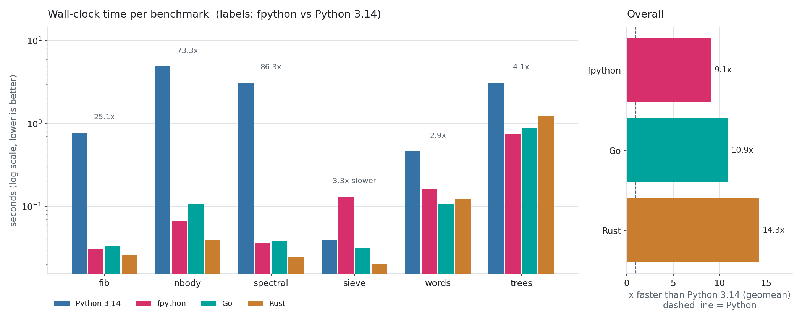

# fpython benchmarks

Machine: macOS-26.6-arm64-arm-64bit-Mach-O / arm64, 16 CPUs. Best of 3 runs (after one warm-up), wall-clock seconds, including process start-up.

- **Python 3.14**: regular, idiomatic Python (`bench/python/*.py`: no annotations, fast builtins).
- **Go** / **Rust**: idiomatic ports (`bench/go`, `bench/rust`) as native reference points.

| benchmark | fpython | Python 3.14 | Go | Rust | fpython vs Python | fpython vs Go | fpython vs Rust |
|---|---:|---:|---:|---:|---:|---:|---:|
| fib | 0.031 | 0.777 | 0.034 | 0.026 | 25.1x faster | 1.1x faster | 1.18x slower |
| nbody | 0.067 | 4.908 | 0.107 | 0.040 | 73.3x faster | 1.6x faster | 1.67x slower |
| spectral | 0.036 | 3.132 | 0.038 | 0.025 | 86.3x faster | 1.1x faster | 1.46x slower |
| sieve | 0.132 | 0.040 | 0.031 | 0.020 | 3.31x slower | 4.21x slower | 6.50x slower |
| words | 0.161 | 0.466 | 0.107 | 0.124 | 2.9x faster | 1.51x slower | 1.30x slower |
| trees | 0.759 | 3.114 | 0.892 | 1.247 | 4.1x faster | 1.2x faster | 1.6x faster |

Geometric mean (seconds): fpython 0.103, Python 3.14 0.941, Go 0.086, Rust 0.066

fpython is **9.1x faster than Python 3.14** (geometric mean).
fpython runs at **0.83x the speed of Go** and **0.64x the speed of Rust** (geometric mean; >1 means faster).

Workloads: `fib` (recursion), `nbody` (float math on objects), `spectral` (nested float loops),
`sieve` (list-of-bool scanning), `words` (string building, split, dict counting, sorting),
`trees` (allocation-heavy binary trees, exercises the GC).

Reproduce: `cargo build --release && python3 bench/run.py` (the chart needs matplotlib; redraw it
from `bench/results.json` with `python3 bench/chart.py`).
